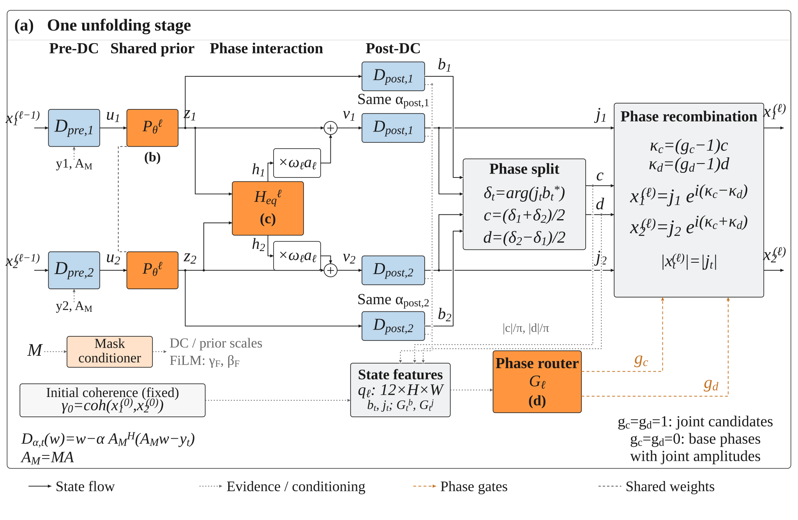
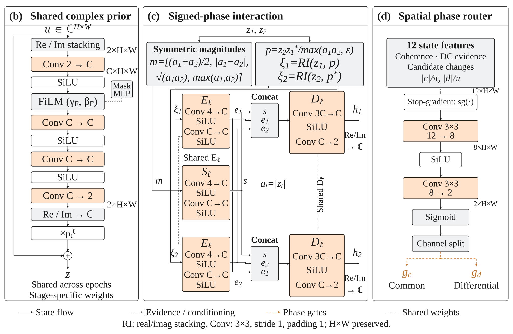

# Revised DP-JMRNet architecture

The default pipeline uses <code>SplitPhaseUtilityUnfolding256</code>, with five unfolding stages, 16 backbone channels, signed relative-phase features, and a stage-specific 12→8→2 spatial phase router. The shared sampling mask is frozen during training and inference. The supplied router initialization is 0.5 for both outputs.

## Base and joint candidates

The base candidate bypasses the current stage's cross-epoch interaction. The joint candidate includes that interaction. Both candidates use the same post-DC step for a given epoch. DC gradients used as evidence are evaluated at the branch inputs, before that post-DC update.

The interaction endpoint encoder takes four channels: the real and imaginary parts of its own complex image, the cosine of the relative phase, and the signed sine of that phase. For the second endpoint, the sine changes sign. Shared encoders and a shared decoder applied in reversed endpoint orders enforce the exchange-equivariant construction.

## Router input channels

Each entry below is an H×W feature map. The order matches <code>UtilitySelectiveUnfolding256._features</code>, followed by the two phase-increment maps in <code>SplitPhaseUtilityUnfolding256.forward</code>.

| Channel | Quantity | Interpretation |
|:--|:--|:--|
| 1 | Initial coherence | Fixed correlation anchor from the initial adjoint reconstructions. |
| 2 | Current base coherence | Local complex correlation of the current base pair. |
| 3 | Mean normalized DC burden | Mean of the two bounded, per-image RMS-normalized gradient magnitudes. |
| 4 | DC burden imbalance | Absolute difference of those two normalized burdens. |
| 5 | Relative candidate change | Complex joint-minus-base change relative to base amplitude, clipped and scaled to [0, 1]. |
| 6 | DC direction alignment | Mean alignment of candidate changes with the negative base-branch DC gradients. |
| 7 | Circular differential-phase change | Wrapped difference between joint and base differential phases, normalized by π. |
| 8 | Base amplitude discrepancy | Normalized absolute amplitude difference between the two base candidates. |
| 9 | Joint amplitude discrepancy | The corresponding difference in the joint pair. |
| 10 | Relative gradient decrease | Comparison of joint- and base-branch input gradient magnitudes, bounded in [−1, 1]. |
| 11 | Common phase increment magnitude | Absolute common increment, normalized by π. |
| 12 | Differential half-increment magnitude | Absolute differential half-increment, normalized by π. |

Coherence uses a 7×7 local average. High coherence indicates concentrated local relative phase, which can be nonzero. Because the statistic is computed from reconstructions, it is a reliability cue rather than a calibrated probability of correct phase. The normalized DC quantities compare local correction burdens with each image's RMS gradient; they are not estimates of noise variance or posterior error probability. Direction alignment and relative gradient decrease are branch-input proxies, not guarantees about the final reconstruction error.

The router detaches its evidence input, then applies a 3×3 convolution (12→8), SiLU, a 3×3 convolution (8→2), and sigmoid. It returns separate common and differential phase-retention maps. No monotonic rule is imposed on any individual feature; high coherence alone does not determine a gate value. Ground-truth images, reference coherence, and reference phase are not router inputs at inference.

## Phase routing and controls

The two principal joint-versus-base phase increments are split into their mean (common increment) and half-difference (differential half-increment). The common and differential gates retain separate fractions of these increments. Recombination rotates the joint candidates and therefore preserves their amplitudes.

- Both phase gates equal one: the joint candidates are retained.
- Both phase gates equal zero: base phases are combined with joint amplitudes.
- <code>coupling_override="always_on"</code>: select the complete joint candidates at every stage.
- <code>coupling_override="independent"</code>: select the complete base candidates at every stage. This is a separate control and is not equivalent to zero phase gates.

The common correction cancels from the current stage's conjugate product. It still changes each complex image and can affect subsequent stages. The common/differential increments are coordinates of the candidate update, not independent estimates of deformation or atmospheric delay. Phase has no physical interpretation at zero complex amplitude.

After the last stage, a shared real/imaginary CNN predicts a bounded phase rotation with scale 0.08 and mask conditioning. It preserves the final-stage amplitude. The differential-phase convention is epoch 2 multiplied by the conjugate of epoch 1.

## Training and compatibility

The supplied training objective contains four terms: normalized complex error, normalized amplitude error, reliability-weighted individual circular-phase RMSE, and reliability-weighted differential circular-phase RMSE. Their weights are 1.0, 0.35, 0.12, and 1.25. The backbone and spatial routers are jointly trained; no utility labels, auxiliary utility loss, or gate regularizers are added.

The legacy analytical-residual-gate implementation is retained for historical comparisons. Its exact-zero independent fallback describes that legacy model only. The revised default keeps the original candidate-feature scaffold and parameter initialization order to support comparison with the local research implementation. Old two-channel endpoint checkpoints require their matching legacy model, rather than loading into the revised four-channel model.
